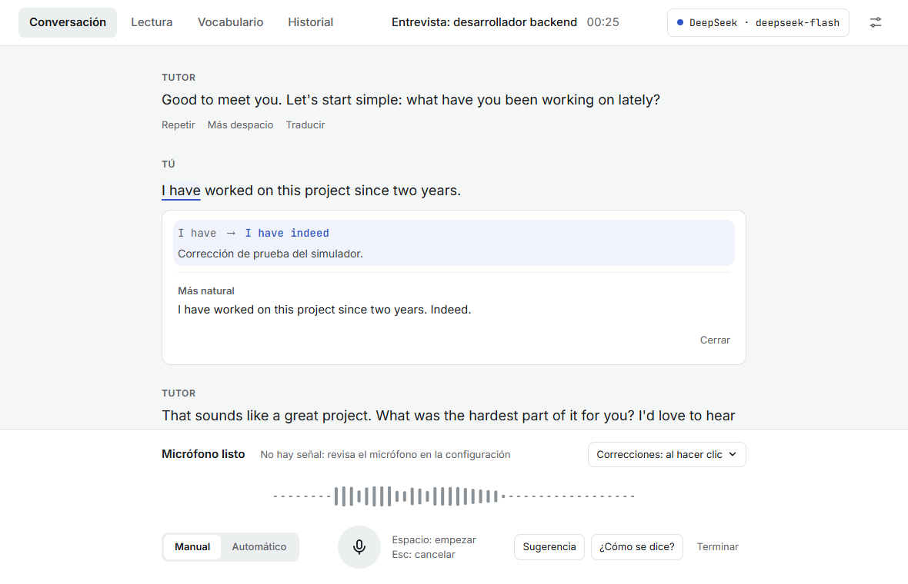
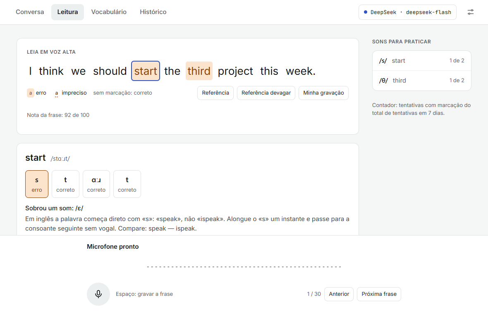

# Voice Tutor

[English](README.md) · [Português (Brasil)](README.pt-BR.md)

Una aplicación de escritorio para Windows para practicar inglés estadounidense hablado, pensada para quienes hablan español latinoamericano o portugués de Brasil. Conversas con un tutor de inteligencia artificial que solo habla inglés estadounidense general; las correcciones, traducciones y consejos llegan en tu idioma, por escrito.

El reconocimiento de voz, la voz del tutor y la revisión de pronunciación funcionan en tu propia tarjeta gráfica NVIDIA. Tu voz nunca sale de la computadora: solo el texto de la conversación va al proveedor de modelos de lenguaje que elijas (o a un modelo en tu propia computadora).

## Qué hace

- **Conversación** en escenarios realistas (entrevista de trabajo, charla informal, reuniones…) en niveles de A2 a C1. Presiona la barra espaciadora para hablar, o solo habla en modo automático; con audífonos puedes interrumpir al tutor con la voz.
- **Correcciones** de gramática, vocabulario y forma de decir las cosas, explicadas en español o portugués, más una forma más natural de decirlo.
- **Resumen de la sesión** con lo más importante, ejercicios de habla a partir de tus errores, los errores que se repiten entre sesiones y frases útiles para tu vocabulario.
- **Lectura**: lee una frase en voz alta y ve sonido por sonido qué corregir, con consejos para los errores típicos de quienes hablan español o portugués («estart», «tink», «berry» por «very»…).
- Repaso de **vocabulario** e **historial** de cada sesión, que se puede exportar a JSON o CSV.
- Funciona con DeepSeek, OpenAI, OpenRouter, Ollama, LM Studio o cualquier servicio compatible con OpenAI. Las claves se guardan solo en el Administrador de credenciales de Windows.

## Requisitos

- Windows 10 22H2 o Windows 11, de 64 bits
- Tarjeta gráfica NVIDIA GeForce RTX serie 20 o más reciente, con 6 GB de memoria de video o más; controlador 572.61 o más reciente
- 16 GB de RAM, unos 15 GB libres en disco
- Un micrófono (mejor con audífonos) y conexión a internet para la instalación y el modelo de lenguaje

Detalles: [requisitos de hardware](docs/es/hardware.md).

## Instalación

1. Descarga `VoiceTutor-<versión>.zip` desde la página de versiones (Releases), haz clic derecho → Propiedades → Desbloquear, y extráelo en una ruta corta como `C:\VoiceTutor`.
2. Haz doble clic en `install.cmd`. Primero revisa tu computadora y luego descarga lo necesario (unos 8 GB), sin permisos de administrador y sin que necesites Python.
3. La aplicación se abre con un asistente de configuración: idioma, revisión del equipo, micrófono, voz, conexión de API y nivel.

Paso a paso: [guía de instalación](docs/es/install.md).

## Documentación

| | English | Español | Português |
| --- | --- | --- | --- |
| Instalación | [install](docs/en/install.md) | [instalación](docs/es/install.md) | [instalação](docs/pt-BR/install.md) |
| Hardware | [hardware](docs/en/hardware.md) | [hardware](docs/es/hardware.md) | [hardware](docs/pt-BR/hardware.md) |
| Claves de API y proveedores | [api-keys](docs/en/api-keys.md) | [claves de API](docs/es/api-keys.md) | [chaves de API](docs/pt-BR/api-keys.md) |
| Uso de la aplicación | [usage](docs/en/usage.md) | [uso](docs/es/usage.md) | [uso](docs/pt-BR/usage.md) |
| Solución de problemas | [troubleshooting](docs/en/troubleshooting.md) | [problemas](docs/es/troubleshooting.md) | [problemas](docs/pt-BR/troubleshooting.md) |
| Privacidad | [privacy](docs/en/privacy.md) | [privacidad](docs/es/privacy.md) | [privacidade](docs/pt-BR/privacy.md) |

## Privacidad en pocas palabras

Sin cuentas, sin telemetría, sin búsqueda de actualizaciones. El audio se procesa solo en tu computadora. Mientras la usas, la aplicación se comunica con un solo servidor: el proveedor de modelos de lenguaje que configuraste. Tus datos se quedan en `%LOCALAPPDATA%\VoiceTutor`. Consulta [privacidad](docs/es/privacy.md).

## Cómo contribuir

Los reportes de errores, las traducciones y los catálogos de pronunciación son bienvenidos: consulta [CONTRIBUTING.md](CONTRIBUTING.md) (en inglés). Problemas de seguridad: [SECURITY.md](SECURITY.md).

## Licencia

MIT, consulta [LICENSE](LICENSE). Los modelos y bibliotecas que descarga el instalador conservan sus propias licencias: [THIRD_PARTY_NOTICES.md](THIRD_PARTY_NOTICES.md).
