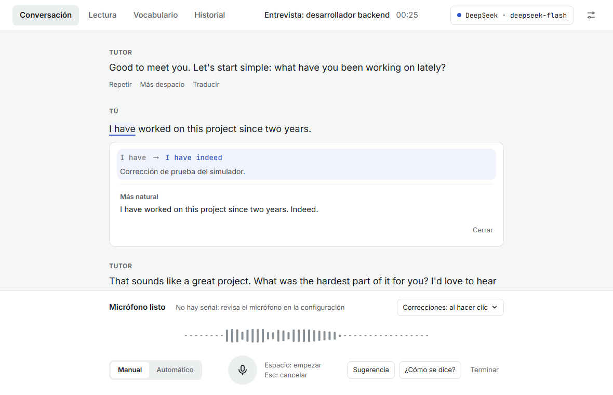
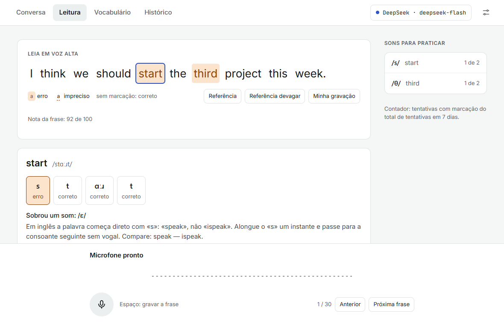

# Personal AI English Teacher (ES/PT) for Desktop/Notebook with GPU

[Español](README.es.md) · [Português (Brasil)](README.pt-BR.md)

A Windows desktop app for practicing spoken American English, for learners who speak Latin American Spanish or Brazilian Portuguese. You talk with an AI tutor that speaks only General American English; corrections, translations and tips come in your own language, as text.

Speech recognition, the tutor's voice and the pronunciation check run on your own NVIDIA graphics card. Your voice never leaves the computer: only the text of the conversation goes to the language-model provider you choose (or to a model on your own computer).

## What it does

- **Conversation** in realistic scenarios (job interview, small talk, meetings…) at levels A2 to C1. Press Space to talk, or just speak in automatic mode; with headphones you can interrupt the tutor by voice.
- **Corrections** of grammar, vocabulary and phrasing, explained in Spanish or Portuguese, plus a more natural way to say it.
- **Session summary** with the key takeaway, speaking exercises built from your mistakes, recurring mistakes across sessions and useful phrases for your vocabulary.
- **Reading**: read a phrase aloud and see sound by sound what to fix, with tips for the mistakes typical of Spanish and Portuguese speakers ("estart", "tink", "berry" for "very"…).
- **Vocabulary** review and a **history** of every session, exportable to JSON or CSV.
- Works with DeepSeek, OpenAI, OpenRouter, Ollama, LM Studio or any OpenAI-compatible service. Keys are stored only in the Windows Credential Manager.

## Requirements

- Windows 10 22H2 or Windows 11, 64-bit
- NVIDIA graphics card, GeForce RTX 20 series or newer, 6 GB of video memory or more; driver 572.61 or newer
- 16 GB of RAM, about 15 GB of free disk space
- A microphone (headphones recommended) and an internet connection for the installation and the language model

Details: [hardware requirements](docs/en/hardware.md).

## Installation

1. Download `EnglishTeacher-<version>.zip` from the [Releases page](https://github.com/KonstantinSmirnov596/personal-ai-english-teacher/releases), right-click → Properties → Unblock, and extract it to a short path such as `C:\EnglishTeacher`.
2. Double-click `install.cmd`. It checks your computer first, then downloads what it needs (about 8 GB), with no administrator rights and no Python of your own.
3. The app opens with a setup wizard: language, hardware check, microphone, voice, API connection and level.

Step by step: [installation guide](docs/en/install.md).

## Documentation

| | English | Español | Português |
| --- | --- | --- | --- |
| Installation | [install](docs/en/install.md) | [instalación](docs/es/install.md) | [instalação](docs/pt-BR/install.md) |
| Hardware | [hardware](docs/en/hardware.md) | [hardware](docs/es/hardware.md) | [hardware](docs/pt-BR/hardware.md) |
| API keys and providers | [api-keys](docs/en/api-keys.md) | [claves de API](docs/es/api-keys.md) | [chaves de API](docs/pt-BR/api-keys.md) |
| Using the app | [usage](docs/en/usage.md) | [uso](docs/es/usage.md) | [uso](docs/pt-BR/usage.md) |
| Troubleshooting | [troubleshooting](docs/en/troubleshooting.md) | [problemas](docs/es/troubleshooting.md) | [problemas](docs/pt-BR/troubleshooting.md) |
| Privacy | [privacy](docs/en/privacy.md) | [privacidad](docs/es/privacy.md) | [privacidade](docs/pt-BR/privacy.md) |

## Privacy in short

No accounts, no telemetry, no update checks. Audio is processed only on your computer. At run time the app talks to one host: the language-model provider you configured. Your data stays in `%LOCALAPPDATA%\VoiceTutor`. See [privacy](docs/en/privacy.md).

## Contributing

Bug reports, translations and pronunciation catalogs are welcome: see [CONTRIBUTING.md](CONTRIBUTING.md). Security problems: [SECURITY.md](SECURITY.md).

## License

MIT, see [LICENSE](LICENSE). The models and libraries the installer downloads keep their own licenses: [THIRD_PARTY_NOTICES.md](THIRD_PARTY_NOTICES.md).
