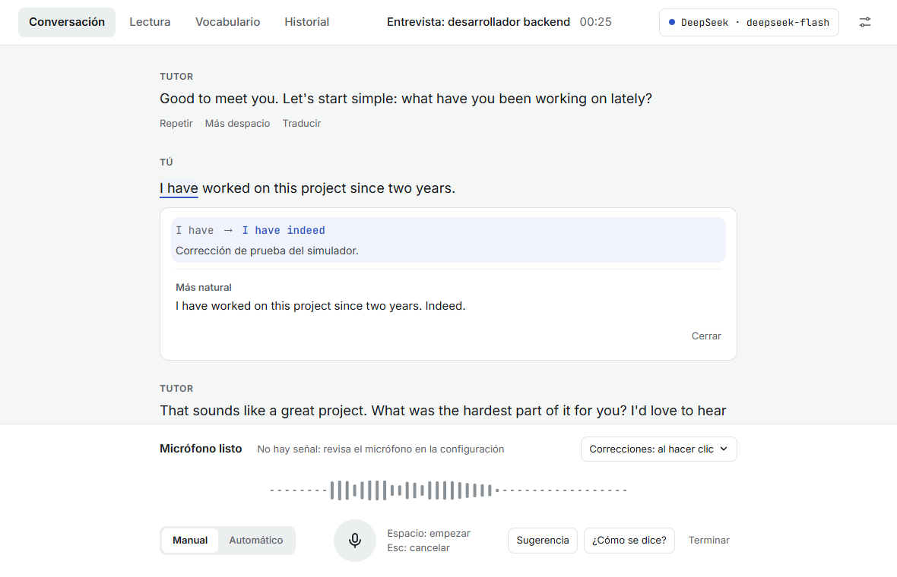
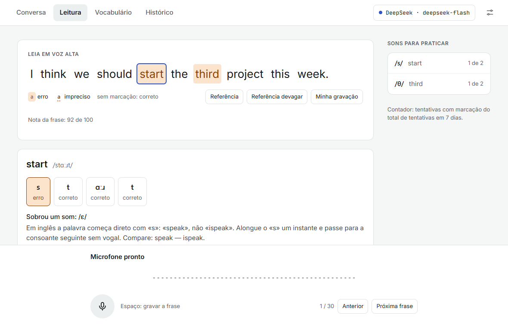

# Voice Tutor

[English](README.md) · [Español](README.es.md)

Um aplicativo de desktop para Windows para praticar inglês americano falado, pensado para quem fala espanhol latino-americano ou português do Brasil. Você conversa com um tutor de inteligência artificial que só fala inglês americano geral; as correções, traduções e dicas chegam no seu idioma, por escrito.

O reconhecimento de voz, a voz do tutor e a avaliação de pronúncia rodam na sua própria placa de vídeo NVIDIA. A sua voz nunca sai do computador: só o texto da conversa vai para o provedor de modelos de linguagem que você escolher (ou para um modelo no seu próprio computador).

## O que ele faz

- **Conversa** em cenários realistas (entrevista de emprego, papo informal, reuniões…) nos níveis A2 a C1. Aperte a barra de espaço para falar, ou só fale no modo automático; com fones de ouvido você pode interromper o tutor com a voz.
- **Correções** de gramática, vocabulário e jeito de dizer as coisas, explicadas em português ou espanhol, mais um jeito mais natural de dizer.
- **Resumo da sessão** com o ponto principal, exercícios de fala a partir dos seus erros, os erros que se repetem entre sessões e frases úteis para o seu vocabulário.
- **Leitura**: leia uma frase em voz alta e veja som por som o que corrigir, com dicas para os erros típicos de quem fala português ou espanhol («estart», «tink», «berry» no lugar de «very»…).
- Revisão de **vocabulário** e **histórico** de cada sessão, que pode ser exportado em JSON ou CSV.
- Funciona com DeepSeek, OpenAI, OpenRouter, Ollama, LM Studio ou qualquer serviço compatível com OpenAI. As chaves ficam só no Gerenciador de Credenciais do Windows.

## Requisitos

- Windows 10 22H2 ou Windows 11, 64 bits
- Placa de vídeo NVIDIA GeForce RTX série 20 ou mais nova, com 6 GB de memória de vídeo ou mais; driver 572.61 ou mais novo
- 16 GB de RAM, cerca de 15 GB livres em disco
- Um microfone (de preferência com fones de ouvido) e conexão com a internet para a instalação e o modelo de linguagem

Detalhes: [requisitos de hardware](docs/pt-BR/hardware.md).

## Instalação

1. Baixe o `VoiceTutor-<versão>.zip` na página de versões (Releases), clique com o botão direito → Propriedades → Desbloquear, e extraia em um caminho curto como `C:\VoiceTutor`.
2. Clique duas vezes no `install.cmd`. Primeiro ele confere o seu computador e depois baixa o necessário (cerca de 8 GB), sem permissão de administrador e sem você precisar de Python.
3. O aplicativo abre com um assistente de configuração: idioma, verificação do computador, microfone, voz, conexão de API e nível.

Passo a passo: [guia de instalação](docs/pt-BR/install.md).

## Documentação

| | English | Español | Português |
| --- | --- | --- | --- |
| Instalação | [install](docs/en/install.md) | [instalación](docs/es/install.md) | [instalação](docs/pt-BR/install.md) |
| Hardware | [hardware](docs/en/hardware.md) | [hardware](docs/es/hardware.md) | [hardware](docs/pt-BR/hardware.md) |
| Chaves de API e provedores | [api-keys](docs/en/api-keys.md) | [claves de API](docs/es/api-keys.md) | [chaves de API](docs/pt-BR/api-keys.md) |
| Uso do aplicativo | [usage](docs/en/usage.md) | [uso](docs/es/usage.md) | [uso](docs/pt-BR/usage.md) |
| Solução de problemas | [troubleshooting](docs/en/troubleshooting.md) | [problemas](docs/es/troubleshooting.md) | [problemas](docs/pt-BR/troubleshooting.md) |
| Privacidade | [privacy](docs/en/privacy.md) | [privacidad](docs/es/privacy.md) | [privacidade](docs/pt-BR/privacy.md) |

## Privacidade em poucas palavras

Sem contas, sem telemetria, sem busca de atualizações. O áudio é processado só no seu computador. Durante o uso, o aplicativo fala com um único servidor: o provedor de modelos de linguagem que você configurou. Os seus dados ficam em `%LOCALAPPDATA%\VoiceTutor`. Veja [privacidade](docs/pt-BR/privacy.md).

## Como contribuir

Relatos de erros, traduções e catálogos de pronúncia são bem-vindos: veja o [CONTRIBUTING.md](CONTRIBUTING.md) (em inglês). Problemas de segurança: [SECURITY.md](SECURITY.md).

## Licença

MIT, veja a [LICENSE](LICENSE). Os modelos e bibliotecas que o instalador baixa mantêm as próprias licenças: [THIRD_PARTY_NOTICES.md](THIRD_PARTY_NOTICES.md).
