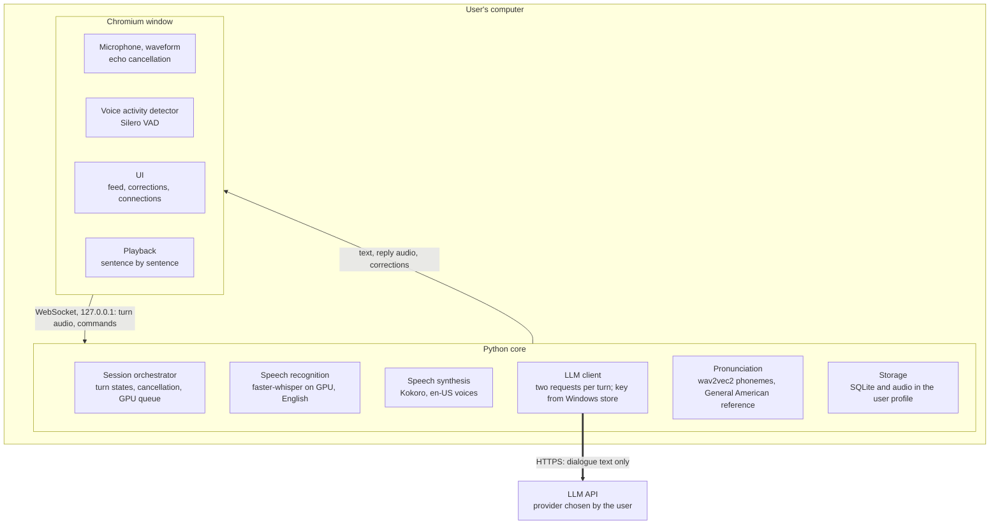
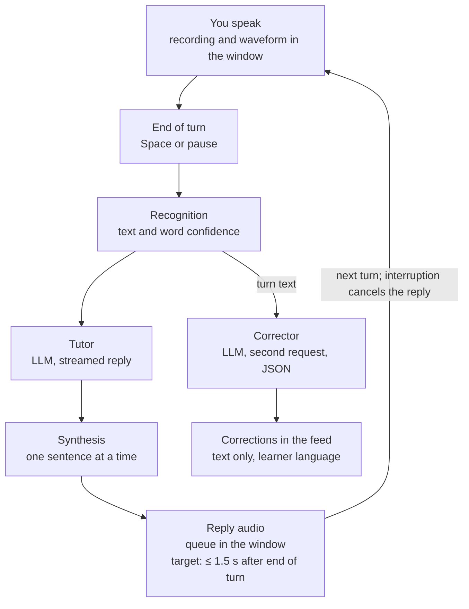
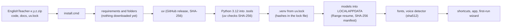

# Personal AI English Teacher: system design

Architecture and key decisions. Static screen mockups are in `docs/ui/`; the window–core contract is in `docs/protocol.md`; the order of work and acceptance criteria are in `docs/PLAN.md`.

## Key decisions

A local Windows app: speech is recognized and synthesized on the user's computer; only dialogue text goes to the LLM API the user picks.

| Question | Decision | Why |
| --- | --- | --- |
| App shape | Python core and a Chromium window, talking over `127.0.0.1` | The Chromium window brings echo cancellation and noise suppression for the microphone; the models live in Python |
| Speech recognition | Local on the NVIDIA GPU, language fixed to English | Audio never leaves the computer, latency is a fraction of a second |
| Dialogue | Any OpenAI-compatible API; the active connection is chosen in a table | One protocol covers DeepSeek, OpenAI, OpenRouter, Ollama, LM Studio and many others |
| Reply and corrections | Two independent requests per turn: "tutor" and "corrector" | The reply starts playing at once; corrections arrive as text a bit later and never slow the conversation |
| Languages | The tutor speaks only American English; corrections and explanations are text in the learner's language (Latin American Spanish or Brazilian Portuguese) | Learner-language text is never spoken, so immersion is not broken |
| Speech synthesis | Local, American voices, sentence by sentence | The first sentence plays while the model is still writing the rest |
| Turn taking | Manual by default: Space starts and ends a turn; automatic end-of-turn detection is an option | Learners think longer; automatic detection cuts them off mid-sentence |
| Pronunciation | A separate phoneme model, General American reference; main mode is reading a given phrase | With a known reference the assessment is most reliable |
| API keys | Windows Credential Manager; the database holds only name, URL and model | The key is not in the app's files |
| Data | SQLite and audio files in the user profile | One user per Windows account, no accounts or cloud |

## Architecture

Two parts on one computer: a Chromium window with sound and UI, and a Python core with models and data.

Audio, recordings and keys stay on the computer. The only arrow leaving it is the LLM client's requests to the chosen API.

| Component | Technology | Note |
| --- | --- | --- |
| Window | Edge in app mode `--app` with its own profile directory | No address bar or extensions; the profile remembers the microphone permission |
| Audio capture and waveform | `getUserMedia` and Web Audio (AudioWorklet, 16 kHz) | Browser echo cancellation and noise suppression; the waveform is drawn while the microphone is open |
| Voice activity detection | Silero VAD via [vad-web](https://docs.vad.ricky0123.com/user-guide/browser/) and onnxruntime-web (WASM) | Model files are served by the core; no external downloads at runtime |
| Core | Python, FastAPI, one process | HTTP for settings and history, WebSocket for the conversation |
| Speech recognition | [faster-whisper](https://github.com/SYSTRAN/faster-whisper), model `turbo` | Language fixed, words come with timings and probabilities |
| Speech synthesis | [Kokoro-82M](https://huggingface.co/hexgrad/Kokoro-82M), `lang_code='a'` | American voices `af_*` and `am_*`, 24 kHz, speed parameter; uses espeak-ng |
| Pronunciation | [wav2vec2-lv-60-espeak-cv-ft](https://huggingface.co/facebook/wav2vec2-lv-60-espeak-cv-ft) + espeak-ng `en-us` | Loaded on first use; unloaded when VRAM runs low |
| Storage | SQLite and audio files | One folder in the user profile |

Why a Chromium window rather than audio in Python: browser capture brings echo cancellation, without which the reply from the speakers gets back into the microphone. The models and the GPU queue live in the core; all three models together take about 4.4 GB of VRAM (measured on an 8 GB laptop GPU).

## Turn flow

After recognition a turn goes into two independent requests: one gives the spoken reply, the other gives text corrections.

The upper branch determines conversation latency; the lower one does not affect it.

- The turn goes to the core in one piece after it ends. Streaming recognition is not needed: a whole phrase is recognized more accurately and the time gain is small.
- Manual mode: Space starts recording, a second Space sends, Esc cancels.
- Auto mode: the voice activity detector ends the turn after a pause; the allowed pause is 1–3 s, 1.5 s by default.
- Interruption closes the LLM stream and clears synthesis and playback queues. The corrector request is not cancelled.
- Voice interruption is only for headphones. On speakers, interrupt with Space; otherwise the reply could interrupt itself.
- GPU models are called one at a time through a single task queue.
- The tutor's reply is cut into sentences (abbreviations, numbers and initials do not split a sentence); each sentence is synthesized and sent at once.
- Long history is folded: above 40 messages the oldest 20 are replaced by a short summary. The beginning of the LLM request stays byte-identical between turns so the provider's context cache works.

## API connections

Connections are rows of a table without a limit. Exactly one row is active; switching takes effect from the next turn.

| Field | Content | Note |
| --- | --- | --- |
| Active | One switch for the whole table | The active row is shown in the main window header |
| Name | Any name | Free text |
| Base URL | Base URL of an OpenAI-compatible API | Templates fill it in (see `docs/reports/providers.md`) |
| Model | Model id | Templates suggest a default |
| Key | Paste field; after saving only the last 4 characters are shown | The full key never returns to the window |
| Extra parameters | Optional JSON merged into every request body | For example, switching off reasoning |
| Test | Button: a short test request | Result: latency in ms or the provider's error |

- On save the key goes to the core once and is written to Windows Credential Manager. The database stores the other fields and the last 4 characters.
- Deleting a row deletes its key. The active row cannot be deleted until another one is chosen.
- When the active connection fails, the feed shows a message with a "Switch to…" button. There is no automatic switching, so text never goes to another provider without the user's decision.

## Corrections

A separate "corrector" request prepares corrections. They are shown only as text in the learner's language and are never spoken.

| Mode | During the conversation | After the conversation |
| --- | --- | --- |
| Immediately | Underline in the turn and a card under it | Summary |
| On click (default) | Underline only; the card opens on click | Summary |
| At the end | Nothing | All corrections in the summary |
| Off | Nothing; the corrector is not called | Nothing |

- Input: the turn text, the tutor's previous line, the learner's level and the words recognition was unsure about.
- Output: JSON with up to three corrections by importance. Each has `quote` (verbatim fragment of the turn), `fix`, `type`, an explanation in the learner's language (at most 20 words) and `pattern` (recurring-mistake key). A separate `better` field holds the whole phrase in natural American English.
- Low-confidence words are not corrected: the error may be the recognizer's, not the learner's.
- `quote` is checked as a substring of the turn. If not found, the correction stays in the card without an underline.
- The norm is American vocabulary, spelling and grammar.

The tutor never corrects out loud. It may naturally reuse the correct form in its reply (a "recast" switch).

Session summary: one key takeaway with a short spoken exercise, the other corrections as a list, phrases to save into the vocabulary. Recurring mistakes are counted by `pattern`: a key seen in three sessions in a row enters the tutor's system prompt as practice focus (at most five keys, most frequent first) and is closed after three sessions without it.

Text helpers, never spoken in the learner's language: "Hint" (two or three possible answers in English), "Translate" (translation of the tutor's last line), "How do I say…?" (type a phrase in your language, get the English), "Repeat" and "Slower" (the tutor's last line again, optionally at 0.8 speed).

## Pronunciation assessment

Only the American variety is assessed: the reference is built for `en-us`, and the main mode is reading a given phrase.

1. **Reference.** The whole phrase goes through espeak-ng `en-us`, so weak forms and flaps match the phoneme model's training data. Word boundaries are restored by dynamic programming. Every position has a list of accepted American variants.
2. **Acoustics.** The wav2vec2 output (392 symbols) is reduced to 52 sound classes, including accent sounds such as a trilled r and /x/.
3. **Alignment.** Forced CTC alignment (Viterbi) gives every phoneme a segment of the recording.
4. **Score.** For every phoneme, on a window of ±2 neighbours, the CTC likelihood of the reference is compared with the reference where the phoneme is replaced by a competitor: another sound, a deletion or a sequence. All variants are computed in one GPU batch.
5. **Diagnosis and tip.** The sound heard is the most likely competitor. The pair "expected → heard" is looked up in the learner language's catalog of typical mistakes, which gives the tip and a minimal pair.
6. **Thresholds.** Catalog mistake: "close" from 1.25, "error" from 2.0. Substitution outside the catalog: 3.5 and 7.0. "That was right" raises the threshold of the sound by at least 1.0, up to 12.

American tolerances: intervocalic /t/ may be a flap [ɾ]; /ɑ/ and /ɔ/ (cot–caught) are interchangeable; an unreleased final /t/ is accepted; weak vowels and weak forms of function words are not penalized.

In free conversation the assessment is more cautious: only words recognized with confidence ≥ 0.9, only catalog mistakes, with a higher threshold. It runs after the first reply audio and does not delay the conversation.

Limitations: sound-level assessment is a heuristic; thresholds were tuned on synthetic American voices and are calibrated per user with "That was right"; intonation and stress are not assessed.

## Hardware and profiles

SPEC 7. One module reads the computer (`voicetutor/hardware.py`: `nvidia-smi`, Win32 memory and power status, free disk) and is passed to the core as a dependency; tests pass fakes. `voicetutor/profiles.py` turns the facts into per-item checks and a profile:

| Profile | Speech recognition | Phoneme model | Conversation marks |
| --- | --- | --- | --- |
| `completo` | Whisper turbo `float16` | Kept once loaded | On |
| `compacto` | Whisper turbo `int8_float16` | Loaded on demand, unloaded after 5 min idle | Off by default |
| unsupported | Not loaded | Not loaded | — |

At every start the core estimates the profile from the card's total memory (a stored measurement of the same GPU wins; a manual choice in Settings → Performance wins over both) and loads nothing on unsupported hardware. The first-run wizard (`web/js/wizard.js`) measures free memory, counting the memory the app's own models hold, runs a short benchmark (`voicetutor/benchmark.py`) and stores the result in `hardware_profile`. A changed GPU or driver raises a notice that offers the measurement again.

Video memory shortage: recognition that runs out of memory frees the phoneme model and retries once, then answers `vram_low`; the process stays up. On Windows, drivers from 536.40 usually fall back to system memory first, so a shortage mostly makes the app slower.

The installer checks the same requirements before downloading anything (`scripts/requirements.ps1`). The app itself never downloads models.

## Interface

Four screens and a permanent bottom panel with the microphone waveform. Static mockups: `docs/ui/main.html`, `connections.html`, `reading.html`, `summary.html`; design tokens in `docs/ui/README.md`.

| Screen | Content | Key decision |
| --- | --- | --- |
| Conversation | Turn feed, marks in your turn, correction card, bottom panel | The tutor is not visualized: only text and audio. Learner-language text only in cards |
| API connections | Rows, active switch, new-row form | After saving, the key is shown as `••••a1b2` |
| Reading | Phrase with word marks, word breakdown by sounds, tip, reference and own recording | Correct words unmarked, "close" dotted, "error" filled |
| Summary | Key takeaway with exercise, corrections, recurring mistakes, sounds, phrases | The only accent on the screen is the key takeaway |

Bottom panel: the waveform is drawn while the microphone is open (grey in silence, blue while recording, grey with the tutor's level while it speaks); the state is shown above it; the microphone button duplicates Space; "Manual / Auto" and the corrections mode are in the panel.

Look: light neutral theme, Inter font, one blue accent for the active state and corrections, orange only for pronunciation. Marks differ not only by colour: grammar is underlined, pronunciation filled, "close" dotted.

## Data and storage

Everything lives in one per-user folder, `%LOCALAPPDATA%\VoiceTutor`: SQLite database, audio, models, logs, Edge profile.

| Table | Content |
| --- | --- |
| `connection` | Name, URL, model, extra parameters, last 4 key characters, active flag, last test result |
| `setting` | Turn mode, allowed pause, corrections mode, voice, speed, level, audio retention, and the other settings |
| `scenario` | Built-in and custom scenarios |
| `session` | Scenario, time, connection and model used, summary |
| `turn` | Role, text, words with timings and confidence, audio path, latency measurements |
| `correction` | Fragment, fix, type, explanation, pattern key |
| `pattern` | Recurring mistake: counter, last seen, sessions without it |
| `vocab` | Phrase, translation, context, next review date |
| `pron_attempt` | Reading attempt: text, audio, score, phoneme results |
| `pron_sound` | Per-sound statistics: attempts, errors, sensitivity offset |
| `hardware_profile` | First-run measurements: GPU, driver, memory, profile, timings |

- No API keys in the database.
- Turn audio is kept as files for 30 days by default; 0 disables storage. Old files are removed at start and every 6 hours.
- Sessions and vocabulary export to JSON and CSV without keys.
- A backup is a copy of the folder; on another computer keys are entered again.

## Installation and distribution

SPEC 8: no executable; a release archive with the source and a script that needs neither Python nor administrator rights.

| Piece | Where | Note |
| --- | --- | --- |
| `install.cmd` → `scripts/setup.ps1` | App folder | Safe to run again; continues where it stopped |
| `scripts/requirements.ps1` | Installer | Same thresholds as `voicetutor/profiles.py`; messages in en, es, pt-BR |
| `scripts/installer.ps1` | Installer | uv pin, folder checks (writable, ASCII short name for espeak-ng, length) |
| `voicetutor/model_download.py` | Installer only | The app never downloads; `voicetutor/data/model_files.json` holds size and SHA-256 per file |
| `uninstall.cmd` → `scripts/uninstall.ps1` | App folder | Data and keys only after a separate confirmation |
| `scripts/make_release.ps1` | Developer | Archive without models, environment, binaries or tests; `SHA256SUMS.txt` |
| `scripts/collect_diagnostics.ps1` | User | Versions, profile, logs; keys, user name and conversation text removed |

Folders with accented letters work: espeak-ng, which reads its data through the ANSI file API, gets the folder's 8.3 short name (`voicetutor/espeak_path.py`).

## Security

The only external exchange is HTTPS requests to the active connection's URL (or plain HTTP to `127.0.0.1` for local model servers).

| Asset | Measure | Boundary |
| --- | --- | --- |
| API keys | Windows Credential Manager via [keyring](https://github.com/jaraco/keyring); the window gets only the last 4 characters; keys are cut out of logs and never exported | Any program running under the same Windows account can read the key: use a separate key with a spending limit |
| Local server | Listens only on `127.0.0.1`. Requires a single-use launch token exchanged for an `HttpOnly`, `SameSite=Strict` cookie. Checks `Origin` and `Host` for HTTP and WebSocket. No CORS | Blocks other websites from talking to the local port (WebSocket hijacking, DNS rebinding) |
| Outbound requests | Only to the active connection and the row being tested; HTTPS with certificate checks for non-local hosts; `trust_env=False` (no system proxies). No telemetry | Models are downloaded once at install time; at runtime the model libraries run offline |
| Data for the provider | Turn texts, tutor replies and system prompts. Never audio | The provider stores text under its own policy: do not dictate passwords or other people's personal data |
| Window | All resources are local, CSP forbids external loads. LLM answers are inserted as text, not HTML. LLM JSON is validated against a schema | The LLM has no tools, so an injected instruction has nothing to act with |
| Dependencies and models | Versions pinned in the lock file; models pinned to commits of their official repositories; weights loaded as safetensors or with `weights_only` | Pickle weights could run code on load |
| Local data | Folder in the user profile, audio retention period, "Delete all data" | Disk protection is BitLocker or Windows device encryption; the database is not encrypted separately |

Deliberately not done: TLS on localhost, user accounts and database encryption — the app has one user per Windows account and no inbound connections.

## Sources

- [faster-whisper](https://github.com/SYSTRAN/faster-whisper), [Kokoro-82M](https://huggingface.co/hexgrad/Kokoro-82M), [wav2vec2-lv-60-espeak-cv-ft](https://huggingface.co/facebook/wav2vec2-lv-60-espeak-cv-ft)
- [vad-web: voice activity detection in the browser](https://docs.vad.ricky0123.com/user-guide/browser/)
- [GOP scores for mispronunciation detection](https://arxiv.org/pdf/2506.12067)
- [keyring](https://github.com/jaraco/keyring)
